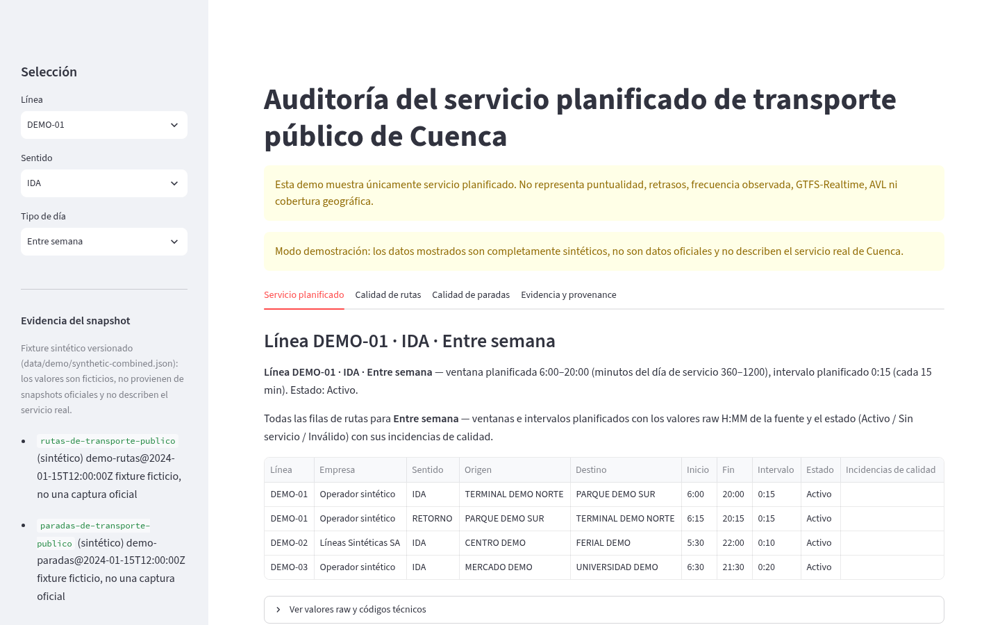

# Auditoría del servicio planificado de transporte público de Cuenca

> Auditoría reproducible del servicio **planificado** de transporte público de Cuenca: rutas, paradas, ventanas e intervalos planificados y evidencia de los dos snapshots aprobados. Este proyecto NO mide retrasos reales, puntualidad, desempeño en tiempo ni frecuencia observada, y NO establece cobertura geográfica: las coordenadas de las paradas son texto sin resolver (`format_unresolved`), por lo que la demo no muestra mapa. El contexto meteorológico, el análisis entre snapshots y el análisis geoespacial son trabajo futuro, todavía no implementado.

## Resumen ejecutivo

**Qué es.** Una auditoría reproducible del servicio **planificado** de transporte público de Cuenca, construida únicamente con los dos snapshots aprobados de Cuenca en Datos (rutas y paradas). Cada captura se valida de forma estricta contra su manifest (fail closed), se transforma al modelo canónico (`source_snapshot`, `mobility_network`, `planned_service`, `quality_report`) y se explora con una demo local de Streamlit de solo lectura.

**Implementado (MVP actual).**

- Rutas: 76 filas · Paradas: 383 filas, con métricas de calidad fijadas por tests (4 ORIGEN/DESTINO sin valor, IDA 38 / RETORNO 38, 684 celdas de horario válidas, 228 intervalos válidos, 8 ventanas sin servicio, `68/76` filas limpias del snapshot validado; 0 geometrías válidas).
- `planned_service`: un registro canónico por **fila de ruta × tipo de día** (`weekday`/`saturday`/`sunday`) con inicio/fin/intervalo planificados **relativos al día de servicio** (H:MM raw + minutos tipados). Es planificación publicada por la fuente, **nunca una observación**.
- Demo sin mapa por decisión de calidad: el formato de las coordenadas, el orden de los ejes y el CRS no están resueltos (`format_unresolved`).
- Arquitectura: `mobility_reliability` (ingestión/validación/transformación/calidad) + `app/` (demo de solo lectura). Contrato de fuente: `docs/source-contract.md`. Métricas/provenance por snapshot en la demo y en `data/quality/coordinate-format-audit.json`.

**Qué NO es.** No mide puntualidad, retrasos, frecuencia observada, GTFS-Realtime, AVL ni cobertura geográfica; no hay geometría validada, las coordenadas nunca se corrigen y no se hace inferencia geográfica.

**Pendiente o bloqueado (futuro, no implementado).** Contexto meteorológico (INAMHI/NCEI/Open-Meteo), análisis entre snapshots, análisis geoespacial y mapas (bloqueado por la resolución de coordenadas), verificaciones de frescura y movilidad observada (requiere una fuente GTFS-Realtime/AVL autorizada).

**Pruebas.** Suite pytest (251 casos) con triangulación sobre las capturas reales cuando los raws están presentes y tests del modo demostración sintético (loader y AppTest); ver [Verificación](#verificación) en la sección de la demo local.

**Siguiente paso.** Resolver el formato/CRS de las coordenadas con la documentación oficial de la fuente; recién entonces evaluar mapas y análisis geoespacial. Todo cambio de alcance revisa primero `docs/source-contract.md`.

## Estado del proyecto

**Adquisición de snapshots, transformación canónica y demo local sin conexión implementadas; análisis y contexto meteorológico no iniciados.** El contrato autoritativo de fuente y alcance es [`docs/source-contract.md`](docs/source-contract.md). La recopilación de snapshots de los dos datasets aprobados de Cuenca en Datos (rutas y paradas) está implementada y probada, y la transformación canónica de servicio planificado — `source_snapshot`, `mobility_network`, `planned_service` y `quality_report` por snapshot — está implementada y probada con validación estricta manifest/raw sin conexión (ver [Transformación canónica](#transformación-canónica)). El hito de demo agrega una app de Streamlit de solo lectura y respaldada por snapshots bajo `app/` que renderiza la salida canónica y la auditoría de coordenadas (ver [Demo local](#demo-local-streamlit-sin-conexión)); por decisión de calidad no muestra **ningún mapa** porque el formato de las coordenadas, el orden de los ejes y el CRS no están resueltos. El análisis y el contexto meteorológico siguen pendientes. Este README es el contrato a nivel de proyecto y se actualizará a medida que el sistema se vuelva real. La auditoría de fuentes está completa para el límite del MVP; este documento no hace afirmaciones de cobertura de datos más allá de lo que estableció la auditoría.

## Recopilación de snapshots

Captura un snapshot **actual** por dataset aprobado a través de la API documentada CKAN `package_show`. No hay recopilación histórica masiva.

### Comandos de captura

```bash
uv run python -m mobility_reliability.ingestion.ckan_snapshot --dataset routes
uv run python -m mobility_reliability.ingestion.ckan_snapshot --dataset stops
# ambos datasets: --dataset all
```

Cada ejecución escribe una captura raw y un manifest pequeño, y nunca sobrescribe archivos existentes:

| Dataset | URL de CKAN package_show | Captura raw (`data/raw/`, ignorada por git) | Manifest (`data/manifests/`, versionado) |
| --- | --- | --- | --- |
| Rutas | `…/api/3/action/package_show?id=rutas-de-transporte-publico` | `data/raw/rutas-de-transporte-publico/<UTC-stamp>.json` | `data/manifests/rutas-de-transporte-publico/<UTC-stamp>.manifest.json` |
| Paradas | `…/api/3/action/package_show?id=paradas-de-transporte-publico` | `data/raw/paradas-de-transporte-publico/<UTC-stamp>.json` | `data/manifests/paradas-de-transporte-publico/<UTC-stamp>.manifest.json` |

Comportamiento:

- Los bytes raw se conservan **exactamente como se descargaron** (nunca se reserializan); el `content_hash` del manifest es su SHA-256 y `raw_file` es relativo a `data/raw/`.
- La huella de licencia publicada (`license_id=cc-nc` más la URL oficial de la licencia CC BY-NC 2.0) se verifica antes de descargar nada. **La selección de recursos es determinista y nunca posicional**: solo son elegibles los recursos CSV que no identifican datos de geometría/geoespaciales (se comparan id/name/description/url, p. ej. `Geo`/`georreferenciadas`/`recorrido`/`shapes`), y gana el CSV aprobado **más nuevo** — la clave de recencia es la señal más reciente entre la fecha de corte de datos incrustada en el nombre/descripción (p. ej. `2025Abril`, `2022Septiembre`) y las fechas de los metadatos del recurso, con el id de recurso estable como desempate final. ZIP/ODS/GeoJSON y los recursos de geometría nunca se seleccionan. Un título genérico de licencia CKAN se acepta con una advertencia.
- Los manifests llevan `status`: `success`, `partial` (desajuste de Content-Length — los bytes recibidos se conservan y se hashean) o `failed`. **Invariantes de manifest fallido**: los fallos previos a la descarga nunca declaran un archivo raw (`raw_file`, `content_hash` y `row_count` permanecen null); cuando un CSV descargado falla la decodificación/parseo (p. ej. UTF-8 inválido), los bytes exactos se conservan primero y el manifest fallido los referencia, con `row_count` null.
- `content_hash` siempre se calcula y se verifica contra el archivo raw **en disco** antes de escribir el manifest; un fallo de verificación elimina el raw y no deja manifest.
- Los destinos raw/manifest existentes lanzan `FileExistsError` antes de cualquier llamada de red: vuelve a ejecutar con una marca de tiempo posterior en lugar de sobrescribir.
- **Los manifests históricos nunca se reescriben en silencio.** Un manifest fallido cuyo archivo raw declarado falta (un *huérfano*) se repara sin conexión con `supersede_orphan_manifest(...)`, que escribe un sidecar exclusivo `.manifest.correction.json` junto a él con `status: superseded`, `raw_verifiable: false`, `raw_file`/`content_hash` de nivel superior null, y la ruta/hash originales conservados solo bajo `unverified_original_claims` — no hay raw disponible y el hash original no está confirmado. El archivo manifest original permanece byte por byte idéntico.
- Verifica una captura contra su manifest con `sha256sum`:

```bash
sha256sum data/raw/rutas-de-transporte-publico/<UTC-stamp>.json
# compara el hash impreso con content_hash en data/manifests/rutas-de-transporte-publico/<UTC-stamp>.manifest.json
```

La segunda captura en vivo autorizada se ejecutó una vez el `2026-08-02T18:51:08Z` con `--dataset all`. Hizo dos solicitudes `package_show` y dos solicitudes de recursos CSV. Rutas completó con éxito; paradas falló la validación del cuerpo porque el CSV descargado no era UTF-8 válido (`0x90` en la posición de byte `32121`), y porque se había seleccionado el CSV de primera posición (septiembre de 2022) en lugar del CSV más nuevo de abril de 2025 (`GADCuenca_ParadasTransporte_2025Abril.csv`, recurso `ed2f1b0f-73e5-4a59-acb4-394f8ec36d7e`) que exige ahora la política determinista de selección del más nuevo. La captura raw y el manifest de rutas siguen siendo válidos. El manifest fallido de paradas (que declaraba un `raw_file`/`content_hash` huérfano porque el cuerpo inválido no se persistió) se **reemplazó vía un sidecar de corrección** — `2026-08-02T18-51-08Z.manifest.correction.json` — que registra `status: superseded`, `raw_verifiable: false`, y la ruta/hash originales solo como afirmaciones no verificadas; el manifest original no se reescribió. **En este hito de corrección no ocurrió ninguna captura nueva**: el colector ahora conserva los bytes exactos ante fallos de decodificación y verifica los hashes contra el raw en disco, pero no se hizo ninguna solicitud de red ni captura para aplicar estas correcciones. No se capturó ningún lote histórico, geometría, clima ni datos operativos. Los manifests fallidos históricos permanecen **inmutables**, y esta compatibilidad técnica de licencia no es asesoramiento legal. No volver a ejecutar sin una autorización nueva y explícita.

Una captura autorizada de seguimiento de paradas se ejecutó a las `2026-08-02T19:27:36Z` y **tuvo éxito**: seleccionó el CSV aprobado determinista-más-nuevo `GADCuenca_ParadasTransporte_2025Abril.csv` (recurso `ed2f1b0f-73e5-4a59-acb4-394f8ec36d7e`), conservó las 383 filas exactas descargadas en `data/raw/paradas-de-transporte-publico/2026-08-02T19-27-36Z.json` (SHA-256 `20969d2e6dbc4d91338901f88c2805afaf642b757adfa4be97225c7364bdc62c`), y escribió `data/manifests/paradas-de-transporte-publico/2026-08-02T19-27-36Z.manifest.json` (`status: success`). Los dos snapshots aprobados que usan la transformación y la demo son, por tanto, rutas `2026-08-02T18-51-08Z` (76 filas) y paradas `2026-08-02T19-27-36Z` (383 filas). No se capturó ningún lote histórico, geometría, clima ni datos operativos; ninguna captura adicional está autorizada sin una nueva autorización explícita.

## Transformación canónica

Transforma las capturas validadas en las entidades canónicas de servicio planificado definidas en [`docs/source-contract.md`](docs/source-contract.md) — `source_snapshot`, `mobility_network`, `planned_service` — más un `quality_report` por snapshot. Solo stdlib, totalmente sin conexión: sin red, sin captura, sin escrituras.

### Camino rápido

```python
from mobility_reliability.transformation import transform_captures

combined = transform_captures(
    "data/manifests/rutas-de-transporte-publico/2026-08-02T18-51-08Z.manifest.json",
    "data/manifests/paradas-de-transporte-publico/2026-08-02T19-27-36Z.manifest.json",
    "data/raw",
)
# combined["source_snapshots"]  -> las dos proyecciones source_snapshot
# combined["mobility_network"]  -> 76 elementos de rutas + 383 de paradas
# combined["planned_service"]  -> 228 registros de servicio de rutas (76 filas x 3 tipos de día)
# combined["quality_reports"]  -> un quality_report por snapshot
```

### APIs

| Función | Propósito |
| --- | --- |
| `mobility_reliability.validation.validate_source_snapshot(manifest_path, raw_dir)` | Validación estructural estricta de un manifest + sus bytes raw exactos; devuelve un `SourceSnapshot` (proyección `as_dict()` compatible con JSON más el manifest, la ruta raw, el encabezado CSV y las filas parseadas que usan las transformaciones); lanza `SnapshotValidationError` ante cualquier inconsistencia |
| `mobility_reliability.transformation.transform_snapshot(manifest_path, raw_dir)` | Ejecuta primero la validación estructural y luego devuelve `source_snapshot`, `mobility_network`, `planned_service` y `quality_report` para un snapshot |
| `mobility_reliability.transformation.transform_captures(route_manifest, stops_manifest, raw_dir)` | Ambas capturas aprobadas combinadas: dos `source_snapshots`, registros de red combinados, registros `planned_service` de rutas (las paradas no tienen) y dos reportes de calidad |

### Validación estricta (fail closed)

`validate_source_snapshot` lee el manifest y los bytes raw exactos localmente y lanza `SnapshotValidationError` cuando: el manifest no es un objeto JSON o su estado no es `success`; faltan campos obligatorios o están vacíos; la URL de dataset/fuente no es una de las dos URL exactas aprobadas de CKAN `package_show`; el ID/formato del recurso o los metadatos del recurso seleccionado son inconsistentes; la huella de licencia no es `license_id=cc-nc` más la URL oficial CC BY-NC 2.0; la marca de recopilación estricta UTC es inválida o la marca de publicación de la fuente (`source_published_at`) falta/está vacía/es inválida — se acepta la forma ISO ingenua del portal; `schema_version` es inválido; `raw_file` es absoluto, con traversal o ausente; el SHA-256 está malformado o no coincide con los bytes raw; el UTF-8/CSV está malformado o desalineado (ragged); `row_count` difiere de las filas de datos CSV reales; o los metadatos del paquete (`source_metadata`) no son un objeto, su `name` no coincide con el dataset, o su lista `resources` no contiene el ID del recurso seleccionado. El recurso seleccionado debe ser CSV y no geométrico — se rechazan la geometría de rutas (recorrido), ZIP, ODS y los recursos geoespaciales. Se verifican la atribución y el ID del recurso. Los fallos estructurales lanzan; nunca se degradan a advertencias.

### Transformación raw-preserving

- **Rutas** — un registro `element_type='route'` por fila raw que mapea LINEA/COMPANIA/SENTIDO/ORIGEN/DESTINO; cada columna de entrada se conserva palabra por palabra en `raw`; los campos tipados en blanco se vuelven null (marcados `missing`) y un SENTIDO no vacío fuera de IDA/RETORNO recibe una incidencia de calidad `unknown`; `network_id` estable = snapshot + número de fila; se incluyen provenance e incidencias de calidad por campo (`quality_flags`). No se crea ninguna geometría de rutas.
- **Paradas** — un registro `element_type='stop'` por fila raw (`N` → stop_id, `Ubicacion` → stop_name, `Paleta` → palette, coordenadas tipadas). Las coordenadas usan un parser decimal estricto no heurístico (como máximo un punto decimal, dígitos ASCII) más rangos globales únicamente (latitud [-90, 90], longitud [-180, 180]): `-2.895.956` es sintaxis inválida, `-290.179` está fuera de rango; los valores nunca se corrigen y no se aplica ninguna bounding box de Cuenca. Una geometría de punto existe solo cuando AMBAS coordenadas pasan; los valores raw nunca se corrigen.
- **Horarios** — un registro `planned_service` por fila de ruta y tipo de día (weekday/saturday/sunday) con minutos tipados del día de servicio (`0:09` → 9) y el texto explícito H:MM en `*_raw`; los valores superiores a 24:00 se conservan sin conversión de calendario; el centinela exacto `0:00/0:00/0:00` es `service_status='no_service'` (ceros tipados conservados, nunca una ventana activa inválida); las ventanas activas requieren inicio < fin e intervalo > 0; los fallos de malformación/cronología anulan los valores tipados afectados con incidencias de calidad; `service_date` nunca se inventa (null). El mapeo exacto de las familias de columnas fuente (LUNES_VIERNES/SABADOS/DOMINGOS) a los valores canónicos `weekday`/`saturday`/`sunday` está documentado y probado en [Mapeo fuente → modelo canónico](docs/source-to-canonical-mapping.md).

### Reportes de calidad

Los reportes por snapshot incluyen: conteos de filas/esperados (el conteo esperado es una verificación **no universal** que se aplica solo a los dos IDs de recurso aprobados conocidos — rutas 76, paradas 383), conteos de campos faltantes, duplicados de fila completa y de clave natural (clave de rutas `(LINEA, COMPANIA, SENTIDO, ORIGEN, DESTINO)`; clave de paradas `(N,)`), conteos de SENTIDO desconocido, conteos de coordenadas inválidas y cobertura de puntos válidos, conteos de horarios malformados/inválidos/sin servicio/intervalos, advertencias, errores y cobertura de elementos limpios. Los problemas de calidad de datos permanecen observables como incidencias/advertencias — las filas raw nunca se corrigen ni se descartan en silencio.

Métricas observadas de las dos capturas aprobadas (fijadas por `tests/test_captured_snapshots.py`, que se ejecuta siempre que los raws ignorados por git están presentes):

| Snapshot | Métricas de calidad observadas |
| --- | --- |
| Rutas (76 filas) | ORIGEN sin valor en 4 filas, DESTINO sin valor en las mismas 4 filas; SENTIDO IDA 38 / RETORNO 38; 684 celdas de horario, 0 malformadas, 0 superiores a 24:00; 228 ventanas activas, 0 inválidas; 8 ventanas sin servicio (líneas 21 y 23, ambos sentidos, Sábado/Domingo); 0 duplicados; 68/76 registros limpios |
| Paradas (383 filas) | Todos los campos no vacíos; 0 duplicados; latitud 331 con sintaxis inválida / 48 fuera de rango / 4 válidas; longitud 374 con sintaxis inválida / 4 fuera de rango / 5 válidas; 0 filas con ambas coordenadas válidas (cobertura de puntos 0.0); 5 valores de `Ubicacion` contienen un `?` ASCII literal (conservados, nunca corregidos) |

**Solo planificado:** sin clima, sin GTFS-Realtime/AVL, sin geometría de rutas, sin dashboards y sin afirmaciones de movilidad observada.

## Demo local (Streamlit sin conexión)

Una app de Streamlit de solo lectura renderiza la salida de la transformación canónica y el artefacto de auditoría de coordenadas existente. Nunca escribe, nunca captura, nunca toca la red y nunca vuelve a implementar parsing. **Significado de `planned_service`** (un registro por fila de ruta × tipo de día, con ventana planificada e intervalo planificado — ver [Transformación canónica](#transformación-canónica)) es exactamente lo que muestra la vista de servicio planificado de la demo.



### Modos de la demo

La app decide su modo por la presencia de los dos archivos raw aprobados en `data/raw/` (rutas `2026-08-02T18-51-08Z` y paradas `2026-08-02T19-27-36Z`):

| Modo | Cuándo | Qué muestra | Fixture usado |
| --- | --- | --- | --- |
| **Evidencia real** | Ambos raw aprobados presentes | Los snapshots exactos aprobados: 76 rutas / 383 paradas, hashes y provenance inmutables, auditoría real `format_unresolved` | Nunca |
| **Demostración (sintético)** | Ningún raw aprobado presente (p. ej. checkout limpio) | Valores **ficticios** canónico-shaped del fixture versionado, etiquetados de forma prominente | `data/demo/synthetic-combined.json` |

El modo demostración muestra **antes de cualquier métrica** el aviso exacto: **«Modo demostración: los datos mostrados son completamente sintéticos, no son datos oficiales y no describen el servicio real de Cuenca.»** La barra lateral y la pestaña de evidencia distinguen el fixture de los snapshots oficiales y nunca muestran hashes, IDs de recurso, URLs de fuente ni licencias reales. Reglas fail-closed (sin respaldo sintético): si existe **exactamente un** raw aprobado, o la evidencia real es inválida, o el fixture está ausente/malformado/inválido, la app muestra un cartel de error claro con la identidad esperada — sin rastreos de error y sin valores inventados. Ver `data/demo/README.md` para autoría, limitaciones y reutilización del fixture.

### Inicio rápido

```bash
uv run --extra demo streamlit run app/streamlit_app.py
```

- Requiere el extra opcional `demo` (`streamlit==1.60.0`), fijado a la versión disponible en la caché local de uv para que resuelva completamente sin conexión. Para instalar sin conexión primero: `UV_OFFLINE=1 uv sync --extra demo` (o `UV_OFFLINE=1 uv run --extra demo streamlit run app/streamlit_app.py`). Streamlit **no** es una dependencia base; la suite base funciona sin él.
- La app lee únicamente `data/manifests/…`, los `data/raw/…` ignorados por git, `data/quality/coordinate-format-audit.json` y (solo en modo demostración) `data/demo/synthetic-combined.json`. Cuando falta un manifest, un archivo raw es el único presente, la evidencia real falla la validación estricta o el fixture falta/es inválido, muestra un cartel de error claro con la identidad esperada de la fuente — sin rastreos de error y sin valores inventados.
- Cada ejecución muestra el aviso de límite planificado: **esto es servicio planificado, no puntualidad, retrasos, frecuencia observada, GTFS-Realtime, AVL ni cobertura geográfica.**

### Vistas

| Vista | Qué muestra |
| --- | --- |
| Servicio planificado | Las 76 filas de rutas para el tipo de día seleccionado: ventanas/intervalos planificados (H:MM raw + minutos del día de servicio), estado Activo / Sin servicio / Inválido, incidencias de calidad, las 8 ventanas sin servicio, provenance |
| Calidad de rutas | 76 filas; ORIGEN sin valor 4, DESTINO sin valor 4; IDA 38 / RETORNO 38; 684 celdas de horario (0 malformadas); 228 intervalos (0 inválidos); 8 ventanas sin servicio; `68/76` etiquetado solo como **filas limpias del snapshot validado**, nunca cobertura geográfica/de red |
| Calidad de paradas | 383 filas; 0 paradas con geometría válida; latitud 331 con sintaxis/problema + 48 fuera de rango; longitud 374 + 4; decisión de auditoría `format_unresolved`; ejemplos raw exactos limitados |
| Evidencia y provenance | Ambos snapshots: IDs de snapshot/recurso, SHA-256 raw, marcas de recopilación, publicación de la fuente, metadatos del recurso, licencia, atribución |

Los números de esta tabla son los del **modo evidencia real**; el **modo
demostración** muestra las mismas cuatro vistas con los valores ficticios del
fixture (4 rutas / 4 paradas, 3 ventanas sin servicio, 0 geometrías).

### Evidencia exacta de la fuente

| Snapshot | Dataset | Recurso | Filas | SHA-256 raw | Licencia declarada |
| --- | --- | --- | --- | --- | --- |
| `rutas-de-transporte-publico@2026-08-02T18-51-08Z` | rutas | `e55af215-4648-4e3b-84c9-d7e929435008` (`GADCuenca_RutasTransporte_2025Marzo.csv`) | 76 | `dc3082ad…88ee07a` | CC BY-NC 2.0 (`cc-nc`) |
| `paradas-de-transporte-publico@2026-08-02T19-27-36Z` | paradas | `ed2f1b0f-73e5-4a59-acb4-394f8ec36d7e` (`GADCuenca_ParadasTransporte_2025Abril.csv`) | 383 | `20969d2e…bdc62c` | CC BY-NC 2.0 (`cc-nc`) |

Las afirmaciones de licencia/provenance están ligadas a estos snapshots exactos y son registros técnicos de compatibilidad, no asesoramiento legal. **Esta tabla aplica únicamente al modo evidencia real**: el modo demostración usa valores ficticios sin hashes, IDs, URLs ni licencias oficiales.

### Decisión de no mostrar mapa

**No se muestra un mapa porque el formato de las coordenadas, el orden de los ejes y el sistema de referencia CRS no están resueltos.** Esta es una decisión de calidad de datos, no una función faltante; `Ubicacion` es el campo de dirección/nombre de la parada y nunca se usa como coordenadas. Ver [`docs/coordinate-quality-audit.md`](docs/coordinate-quality-audit.md).

### Arquitectura

La app solo llama a las APIs canónicas y lee el artefacto de auditoría existente; la transformación y el parsing permanecen en `mobility_reliability`:

| Ruta | Rol |
| --- | --- |
| `app/streamlit_app.py` | Punto de entrada de Streamlit: barra lateral de selección (línea, sentido IDA/RETORNO, tipo de día), indicador de evidencia del snapshot, cuatro vistas, cartel de error ante evidencia faltante |
| `app/_data.py` | Constantes de ruta y cargadores de solo lectura (`transform_captures(...)`, lector del JSON de auditoría, formato de visualización) |
| `app/_views.py` | Modelos de vista puros y deterministas (sin imports de Streamlit, sin parsing, sin conversión) |
| `app/_i18n.py` | Textos de interfaz en español (los códigos canónicos no se traducen) |
| `mobility_reliability/transformation` | Transformación canónica — sin cambios y autoritativa |
| `mobility_reliability/validation` | Validación estricta manifest/raw — sin cambios, falla de forma estricta |

No existe ni detrás de la app ni en ella: conversión de CRS, heurísticas de coordenadas, generación de geometría, mapas, weather/GTFS-RT/AVL ni simulación de retrasos.

### Verificación

```bash
# suite base (no requiere el extra demo; los tests AppTest se omiten sin streamlit)
uv run pytest
# con el extra demo instalado sin conexión
uv run --extra demo pytest
```

## Decisión de alcance (leer primero)

El MVP es una auditoría reproducible del servicio **planificado** de Cuenca — no un producto de retrasos reales ni de puntualidad real:

- **El GTFS estático representa el servicio planificado.** No es GTFS-Realtime: no contiene posiciones de vehículos, ni llegadas o salidas observadas, ni retrasos medidos.
- **El retraso observado, la puntualidad, las cancelaciones y las posiciones de vehículos están fuera del alcance del MVP.** Se reservan para una extensión futura respaldada por una **fuente GTFS-Realtime o AVL autorizada**.
- **Cualquier fuente operativa AVL/GTFS-Realtime está pendiente de autorización y disponibilidad.** Una URL alcanzable no autoriza la recopilación, el uso ni la redistribución.
- Todas las secciones siguientes — objetivo, comportamiento del sistema, demo, métricas, roadmap — están delimitadas por esta decisión.

## Problema

Los usuarios del transporte, los planificadores y los operadores de Cuenca rara vez disponen de una imagen consolidada y reproducible del servicio que está realmente *planificado*: qué rutas y paradas existen y dónde, cuándo hay servicio entre semana y los fines de semana, cuáles son los intervalos planificados y cómo cambió el servicio planificado entre los snapshots históricos publicados entre 2022 y 2025. Esa información está dispersa entre datasets del portal, formatos y versiones de snapshot, y es fácil confundirla con hechos de tiempo real.

Este proyecto convierte datos públicos permitidos de movilidad y clima en una auditoría reproducible y basada en evidencia del servicio planificado, con un contexto meteorológico explícitamente no causal. **Estado de implementación:** el MVP actual cubre solo los dos snapshots de movilidad aprobados (rutas y paradas); la fuente meteorológica, su recopilación y el análisis de contexto meteorológico son una extensión futura — todavía no recopilada, implementada ni afirmada.

## Objetivo del producto

Construir una plataforma de datos pequeña con estilo de producción que responda preguntas sobre el servicio planificado:

- ¿Qué rutas y paradas existen, y dónde?
- ¿Cuáles son las ventanas de servicio planificadas por ruta, sentido y tipo de día?
- ¿Cuáles son los intervalos planificados?
- ¿Cómo cambió la cobertura planificada entre snapshots?
- ¿Qué tan completo, fresco y libre de duplicados es cada snapshot?
- ¿A qué distancia están las estaciones meteorológicas de los corredores de tránsito (solo contexto)?

El producto debe mostrar la evidencia detrás de sus conclusiones. Cada registro conserva su fuente, su hora de recopilación y su historial de transformación.

## Usuarios previstos

- Usuarios del transporte que quieren saber cuándo hay servicio planificado y dónde existe cobertura.
- Planificadores urbanos y de tránsito que evalúan la cobertura planificada y su evolución.
- Operadores de transporte que verifican los horarios publicados y los intervalos planificados.
- Candidatos de datos y ML que demuestran habilidades de series temporales y geoespaciales sobre un dataset real y permitido.

## Qué hará el sistema

> **Nota de estado:** esta es la visión del proyecto, no el estado implementado. Implementado hoy: los puntos 1–5 delimitados por los dos snapshots de movilidad aprobados (auditar/seleccionar, recopilar, preservar el linaje, parsear, validar) más la transformación canónica, la auditoría de coordenadas y la demo local sin conexión. Los puntos 6–9 siguen siendo trabajo futuro: agregación geoespacial (6, bloqueada por la resolución de coordenadas), contexto meteorológico (7, requiere una fuente meteorológica autorizada), reportes entre snapshots (8) y exposición basada en mapa (9 — la demo ya expone la salida canónica, sin mapa).

1. **Auditar y seleccionar** fuentes públicas permitidas de movilidad y clima. Las decisiones están fijadas en `docs/source-contract.md`: Cuenca en Datos para rutas y paradas, INAMHI como fuente meteorológica primaria, NCEI como respaldo histórico, Open-Meteo solo como respaldo modelado/reanálisis etiquetado.
2. **Recopilar** snapshots de fuente con marcas de recopilación y metadatos de fuente.
3. **Recopilar y preservar el linaje**: capturar un snapshot actual por dataset aprobado, registrando URLs de fuente, licencias declaradas y horas de recopilación por snapshot. Los bytes raw viven en `data/raw/` (ignorado por git) y los manifests pequeños en `data/manifests/`; sin descargas históricas masivas y sin fixtures raw versionados. Todo fixture futuro debe ser pequeño, documentado, licenciado/permitido y vinculado a un snapshot de fuente.
4. **Parsear** los campos del servicio planificado (LINEA, COMPANIA, SENTIDO, ORIGEN, DESTINO, inicio/fin/intervalo de `weekday`/`saturday`/`sunday`) y los atributos de las paradas.
5. **Validar** snapshots por completitud, duplicados, frescura y conformidad con el esquema; conservar las horas relativas al día de servicio superiores a 24:00:00 sin conversión ingenua de calendario.
6. **Analizar** la cobertura planificada, las ventanas de servicio y los intervalos a nivel de ruta, parada, corredor y tipo de día, con agregación geoespacial.
7. **Contextualizar** con observaciones meteorológicas de fuentes autorizadas (distancia estación-corredor; sin afirmaciones de causalidad).
8. **Reportar** los cambios entre snapshots y los estados de calidad/fallo como resultados de primera clase.
9. **Exponer** los resultados a través de la demo local sin conexión (sin mapa por decisión de calidad), más los reportes.

## Demo (implementada)

La demo MVP está implementada como una app local de Streamlit sin conexión (`app/streamlit_app.py`) que se entiende en menos de un minuto y muestra deliberadamente **ningún mapa**:

- Vista de servicio planificado: las 76 filas de rutas para el tipo de día seleccionado con ventanas e intervalos planificados (H:MM raw + minutos del día de servicio), estado Activo/Sin servicio/Inválido, incidencias de calidad, las 8 ventanas sin servicio y provenance.
- Vista de calidad de rutas: 76 filas, conteos de ORIGEN/DESTINO sin valor, conteos IDA/RETORNO, validez de horario/intervalos y `68/76` etiquetado solo como filas limpias del snapshot validado — nunca cobertura geográfica/de red completa.
- Vista de calidad de paradas: 383 filas, conteos de coordenadas, decisión de auditoría `format_unresolved`, ejemplos raw exactos limitados y la frase de no-mapa.
- Vista de evidencia/provenance: IDs de snapshot, IDs de recurso, SHA-256 raw, marcas de recopilación, fechas de publicación de la fuente, licencia y atribución de ambas capturas.
- Estado de fallo de fuente: cuando falta un manifest o un raw, un cartel claro lo explica en lugar de un traceback o valores inventados.

El recorrido de 60–90 segundos está en [`docs/demo-script.md`](docs/demo-script.md); el inicio rápido y la nota sin conexión están en [Demo local](#demo-local-streamlit-sin-conexión).

El proyecto tendrá un despliegue público cuando se entiendan las restricciones de hosting. Hasta entonces se requiere una demo local reproducible y un recorrido grabado breve.

## Reproducibilidad y publicación

Un checkout público limpio puede instalar el extra `demo` sin red (`UV_OFFLINE=1 uv sync --extra demo`) e iniciar la app, y **muestra una demo útil de inmediato**: sin los bytes raw permitidos (git-ignorados) la app entra en **modo demostración**, respaldado por el fixture canónico versionado `data/demo/synthetic-combined.json` (valores ficticios creados desde cero, etiquetados de forma prominente como **no oficiales** — ver `data/demo/README.md`). El **modo evidencia real** se describe por separado: con los dos raws aprobados presentes en `data/raw/`, la app usa la validación estricta y los snapshots exactos de siempre (hashes y provenance inmutables), y el fixture **nunca** se usa; evidencia parcial, malformada o inválida falla de forma estricta sin respaldo sintético. La presentación reproducible se apoya en la evidencia versionada: manifests, artefacto de auditoría (`data/quality/coordinate-format-audit.json`), tests que fijan las métricas cuando los raws están presentes, esta documentación y la captura de pantalla del modo demostración en `docs/assets/streamlit-demo.png` (la demo del modo evidencia real se ejecuta localmente con los raws presentes). Los bytes raw no se redistribuyen por licencia; el fixture sintético, en cambio, sí se versiona y tiene su propia declaración de reutilización.

## Alcance

### Producto mínimo viable

Marcadores de estado: `[x]` implementado en el MVP actual · `[ ]` futuro/pendiente.

- [x] Una fuente de movilidad auditada y permitida (Cuenca en Datos rutas/paradas) con los dos snapshots aprobados capturados.
- [ ] Fuente meteorológica (INAMHI primaria; NCEI como respaldo; Open-Meteo solo como respaldo modelado/reanálisis etiquetado) — futura, no recopilada.
- [x] Recopilación reproducible de snapshots con metadatos de recopilación.
- [x] Capas de datos raw y limpiados con métricas de servicio planificado (la lista permitida en `docs/source-contract.md`).
- [x] Entidades canónicas `source_snapshot`, `mobility_network`, `planned_service` (implementadas en la transformación).
- [ ] Contratos canónicos para `weather_observation` y `weather_context` — futuros.
- [ ] Análisis geoespacial a nivel de parada y ruta — futuro, bloqueado por la resolución de coordenadas.
- [x] Una demo interactiva de Streamlit (sin mapa por decisión de calidad hasta resolver las coordenadas).
- [x] Tests automatizados de parsing, validación, cálculo de métricas y caminos de fallo.
- [x] README y contrato de fuente que documentan linaje, métricas, limitaciones y configuración.

### Extensión futura (reservada, no planificada)

- Retraso observado, puntualidad, cancelaciones y posiciones de vehículos — solo con una **fuente GTFS-Realtime o AVL autorizada**; pendiente de autorización y disponibilidad.
- Rutas, ciudades o feeds GTFS adicionales después de una nueva auditoría de fuente.
- Servicio FastAPI para el dataset analítico.
- Ingestión programada y monitoreo de frescura.
- Una extensión ML medida solo después de evaluar una línea base sobre un conjunto de métricas permitido.
- Despliegue local dockerizado y chequeos de CI.

### Explícitamente fuera de alcance

- Rastreo GPS de flotas en tiempo real, telemetría de operadores privados o cualquier uso operativo de AVL/GTFS-Realtime antes de que se confirme la autorización.
- Medición de retrasos observados, gráficos de puntualidad, porcentajes de puntualidad, cancelaciones reales o posiciones de vehículos (reservados para la extensión futura de arriba).
- Hacer scraping de cualquier fuente en violación de sus términos, su política robots o sus controles de acceso.
- Afirmar cobertura de toda la ciudad antes de que la auditoría la demuestre.
- Presentar la correlación climática como causalidad.
- Construir un modelo ML opaco de retrasos sin línea base y evaluación.
- Agregar infraestructura en la nube antes de que el pipeline local sea reproducible.

## Pila técnica propuesta

| Capa | Elección inicial | Propósito |
| --- | --- | --- |
| Lenguaje | Python | Implementación y análisis centrales |
| Entorno | `uv` | Gestión reproducible de dependencias y entorno |
| Calidad | Ruff, pytest, Pandera | Formato/linting, tests y contratos de datos |
| Ingestión | Adaptadores de fuente Python, `httpx`, parsers permitidos | Recopilar datos de snapshot sin acoplar el dominio a una sola fuente |
| Almacenamiento raw | JSON y Parquet/GeoParquet | Preservar la evidencia de fuente y habilitar el desarrollo sin conexión |
| Analítica | pandas y DuckDB | Limpieza, análisis SQL y consultas analíticas locales |
| Geoespacial (futuro, bloqueado) | GeoPandas y un componente de mapa en la demo — no implementado | Futuro análisis y visualización espacial a nivel de parada y ruta, bloqueados por coordenadas no resueltas |
| Demo | Streamlit para el MVP | Demostración pública rápida, legible e interactiva |
| API | FastAPI y Pydantic, luego | Límite de servicio tipado para la aplicación |
| Entrega | Docker y GitHub Actions, luego | Ejecución reproducible y chequeos automatizados |

Las opciones tecnológicas están escalonadas deliberadamente: las métricas de servicio planificado y los chequeos de calidad van primero, las afirmaciones de cobertura preceden al código, y cualquier extensión de retraso observado espera una fuente autorizada.

## Habilidades demostradas

### Ciencia de datos

- Planteamiento del problema y definición de métricas para el servicio planificado (ventanas, intervalos; conteos de rutas/paradas).
- Comparación entre snapshots y manejo de ausencias/vacíos (futuro: los dos snapshots aprobados están capturados, pero el análisis comparativo no está implementado).
- Disciplina de correlación-vs-causalidad: el clima es contexto, nunca causalidad (futuro: todavía no se ha recopilado ningún dato meteorológico).

### Ingeniería de datos

- Adaptadores de fuente y recopilación resiliente de snapshots.
- Capas de datos raw, limpiados y analíticos.
- Diseño de esquemas y contratos de datos.
- Manejo de fallos, frescura e idempotencia.
- Analítica SQL y geoespacial con DuckDB y GeoPandas (futuro, bloqueado por coordenadas no resueltas).

### IA y ML

- Reservado para la extensión futura: modelado con línea base primero y reporte honesto de errores, solo después de que exista una fuente observada autorizada y crezca el conjunto de métricas permitido.

### Software y full stack

- Módulos Python tipados y límites de servicio.
- Experiencia de usuario interactiva a través de la demo local sin conexión de Streamlit (sin mapa por decisión de calidad; un mapa está reservado para la etapa geoespacial futura).
- Tests, documentación, configuración, logging y ejecución reproducible.
- Preparación de CI y despliegue.

### Comunicación profesional

- Planteamiento claro del problema y valor para las partes interesadas.
- Diagramas de arquitectura y de linaje de datos.
- Métricas, compensaciones, limitaciones y análisis de fallos.
- Un video corto de demo y una publicación de LinkedIn enfocada en el resultado más que en la lista de herramientas.

## Plan de evaluación

El proyecto reportará evidencia medible, usando solo las métricas permitidas del MVP:

- Salud de la fuente: tasa de éxito de ingestión y frescura por fuente.
- Calidad de datos: completitud por campo, longitudes de vacíos y tasa de duplicados sobre una muestra revisada.
- Cobertura: conteos de rutas y paradas por snapshot (la evaluación de cobertura geográfica es futura, bloqueada por coordenadas no resueltas).
- Ventanas de servicio planificadas e intervalos planificados por ruta, sentido y tipo de día.
- Cambios entre snapshots (rutas, paradas, ventanas, intervalos).
- Distancia de las estaciones meteorológicas a los corredores de tránsito (futuro: requiere una fuente meteorológica autorizada).
- Tiempo de respuesta del dashboard para la carga de la demo (un mapa solo se agrega después de resolver el formato/CRS de las coordenadas).
- Reproducibilidad desde un entorno limpio usando los snapshots documentados.
- Al menos un fallo inducido intencionalmente (por ejemplo, una fuente ausente) y la respuesta del sistema.

**No evaluado en el MVP** (reservado para una futura fuente GTFS-Realtime/AVL autorizada): retraso observado, puntualidad/porcentaje a tiempo, cancelaciones reales, posiciones de vehículos, confiabilidad del tiempo de viaje y causalidad climática.

Un resultado sólido es una auditoría confiable y explicable del servicio planificado cuyas limitaciones son visibles — no una gran cantidad de rutas.

## Principios de datos y ética

- Usar solo fuentes públicas o explícitamente permitidas.
- Respetar los términos de servicio, las políticas robots, los límites de tasa y los requisitos de atribución (incluida la atribución de datos meteorológicos).
- Almacenar URLs de fuente, licencias declaradas y marcas de recopilación.
- Una URL alcanzable no es autorización: nunca redistribuir un dataset cuya licencia falta o no está clara.
- Evitar datos personales e identificadores innecesarios.
- Política de captura y fixtures: las capturas de producción se limitan a un snapshot actual por dataset aprobado a través de la API CKAN documentada (bytes raw exactos en `data/raw/`, ignorado por git); sin descargas históricas masivas; los tests usan fixtures sintéticos temporales pequeños; todo fixture futuro debe ser pequeño, documentado, licenciado/permitido y vinculado a un snapshot de fuente.
- Documentar la cobertura de la fuente y el sesgo de muestreo; nunca afirmar cobertura que la auditoría no estableció.
- Nunca presentar el dashboard como una estadística oficial de transporte.
- Reportar los vacíos y los estados de fallo como resultados de primera clase, no como notas al pie.

## Reglas de hora y zona horaria

- Conservar la marca de tiempo local original cuando la fuente la proporciona; almacenar la zona horaria IANA (America/Guayaquil para Cuenca); normalizar a UTC donde corresponda.
- Registrar la fecha de servicio GTFS junto con cualquier hora derivada del horario; una fecha de servicio no es una fecha de calendario.
- Conservar las horas relativas al día de servicio superiores a 24:00:00 tal como se publican (por ejemplo, 25:10:00). Nunca convertirlas ingenuamente a fechas de calendario: son relativas a la fecha de servicio, y cualquier interpretación de calendario debe aplicar el desfase del día de servicio explícitamente (25:10:00 en la fecha de servicio D es 01:10 en D+1) y documentarlo.
- La hora del Ecuador continental es UTC−5 todo el año sin horario de verano; derivar UTC de la zona IANA, no fijar desfases en el código.

## Estructura planificada del repositorio

```text
.
├── README.md
├── docs/
│   └── source-contract.md
├── pyproject.toml
├── src/
│   └── mobility_reliability/
│       ├── ingestion/
│       ├── metrics/
│       ├── validation/
│       ├── analytics/
│       └── config.py
├── tests/
├── data/
│   ├── raw/        # capturas actuales, ignoradas por Git
│   └── manifests/  # manifests pequeños por captura, versionados
├── notebooks/
├── app/
└── .github/
    └── workflows/
```

Los datasets raw grandes, las credenciales y el estado de ejecución local no deben versionarse.

## Limitaciones

- **Solo planificado.** La demo muestra servicio planificado: ventanas e intervalos planificados. No es puntualidad, retrasos, frecuencia observada, GTFS-Realtime, AVL ni movilidad en tiempo real, y nunca afirma servicio confiable ni puntual.
- **Sin cobertura geográfica.** Las coordenadas de las paradas son texto sin resolver (`format_unresolved`): no existe geometría validada, no se muestra mapa, las coordenadas nunca se corrigen y no se hace ninguna inferencia geográfica.
- **Evidencia raw preservada y fijada.** Nada se reescribe; las afirmaciones de licencia/provenance se aplican a los dos snapshots exactos listados en [Demo local](#demo-local-streamlit-sin-conexión) y son registros técnicos, no asesoramiento legal.
- **Solo local, con modo demostración explícito.** La demo lee las capturas raw ignoradas por git (modo evidencia real). Un checkout nuevo sin `data/raw/` entra en **modo demostración** con el fixture sintético versionado `data/demo/synthetic-combined.json`, etiquetado de forma prominente como **no oficial** (nunca puede confundirse con evidencia de Cuenca; ver `data/demo/README.md`). Un único raw presente, evidencia real inválida o un fixture ausente/malformado fallan de forma estricta con un cartel de error claro.
- **Sin contexto meteorológico ni análisis entre snapshots todavía.** Ambos son trabajo futuro; la demo es el primer consumidor de la transformación canónica.
- **Discrepancia de wording de `day_type` en el contrato (documentada, no resuelta).** `docs/source-contract.md` (Sección 10.3) usa `weekday/weekend`, mientras que el canónico implementado (Sección 14.2 y código) usa `weekday/saturday/sunday`. Esta pasada de publicación tiene prohibido modificar el contrato, por lo que la discrepancia queda documentada aquí y en [Mapeo fuente → modelo canónico](docs/source-to-canonical-mapping.md), que fija la interpretación a nivel de aplicación usada por el modelo; no se normaliza en silencio y la resolución definitiva queda pendiente del propio contrato.

## Roadmap

- [x] Auditar fuentes de movilidad y clima candidatas y sus restricciones de uso; publicar `docs/source-contract.md`.
- [x] Implementar la recopilación de snapshots de Cuenca en Datos (rutas/paradas) con metadatos de recopilación (snapshot actual por dataset; sin recopilación histórica masiva).
- [x] Implementar parsing, limpieza y cálculo de métricas de servicio planificado (hito de transformación canónica: `source_snapshot`, `mobility_network`, `planned_service`, `quality_report`).
- [ ] Aplicar contratos de esquema canónicos (Pandera) para las cinco entidades del contrato.
- [x] Agregar verificaciones y tests de completitud, duplicados y caminos de fallo (reportes de calidad por snapshot; los fallos estructurales cierran de forma estricta).
- [ ] Agregar verificaciones y tests de frescura.
- [ ] Agregar análisis geoespacial y las primeras visualizaciones de mapa (bloqueado por la resolución de coordenadas).
- [ ] Agregar contexto meteorológico (INAMHI primario; NCEI como respaldo; Open-Meteo solo como respaldo modelado/reanálisis etiquetado).
- [x] Construir la demo local de Streamlit: vistas solo-planificado, calidad de rutas/paradas, evidencia/provenance; sin mapa por decisión de calidad (ver [Demo local](#demo-local-streamlit-sin-conexión)).
- [ ] Agregar un mapa a la demo solo después de resolver el formato, el orden de los ejes y el CRS de las coordenadas.
- [ ] Extensión futura (pendiente de autorización): análisis de retrasos observados desde una fuente GTFS-Realtime/AVL autorizada.
- [ ] Desplegar la demo o publicar un recorrido grabado.
- [ ] Escribir el caso de estudio técnico final y la publicación en LinkedIn.

## Definición de listo

El proyecto está listo para su publicación de portafolio cuando:

- Un nuevo colaborador puede ejecutarlo a partir de las instrucciones documentadas.
- La demo responde una pregunta clara de servicio planificado con evidencia rastreable.
- El pipeline maneja datos faltantes, vacíos y un fallo de fuente.
- Todas las métricas reportadas provienen de la lista de métricas permitidas del MVP en `docs/source-contract.md`.
- Los tests y el CI pasan en la revisión revisada.
- El README y el contrato de fuente explican el alcance, las compensaciones, las limitaciones y los siguientes pasos.
- Un reclutador puede entender el problema, el resultado y el enlace de la demo en menos de dos minutos — incluido lo que el proyecto deliberadamente no mide.

## Licencia

**Datos fuente.** Los dos snapshots aprobados declaran CC BY-NC 2.0 (id de licencia `cc-nc` y URL oficial de Creative Commons), con atribución («GAD Municipal del cantón Cuenca») y restricción no comercial. Los bytes raw capturados **no se versionan** (viven en `data/raw/`, ignorados por git); los manifests versionados registran la huella de licencia verificada de cada snapshot. Esta es una constatación documental de compatibilidad técnica, **no asesoramiento legal**.

**Código del repositorio.** El código original de este repositorio se publica bajo la licencia MIT (ver `LICENSE`). Los datos fuente, capturas raw, manifests, fixtures y demás contenido de terceros no quedan cubiertos por MIT: conservan sus términos independientes documentados (ver `docs/source-contract.md`) y no se otorga ningún derecho implícito sobre material de terceros.

**Dependencia opcional.** La demo usa Streamlit como extra opcional (`demo`), sujeto a su propia licencia (Apache-2.0, verificada en los metadatos de la distribución instalada). Es una dependencia separada e independiente de la licencia de este repositorio y de los datos fuente.
