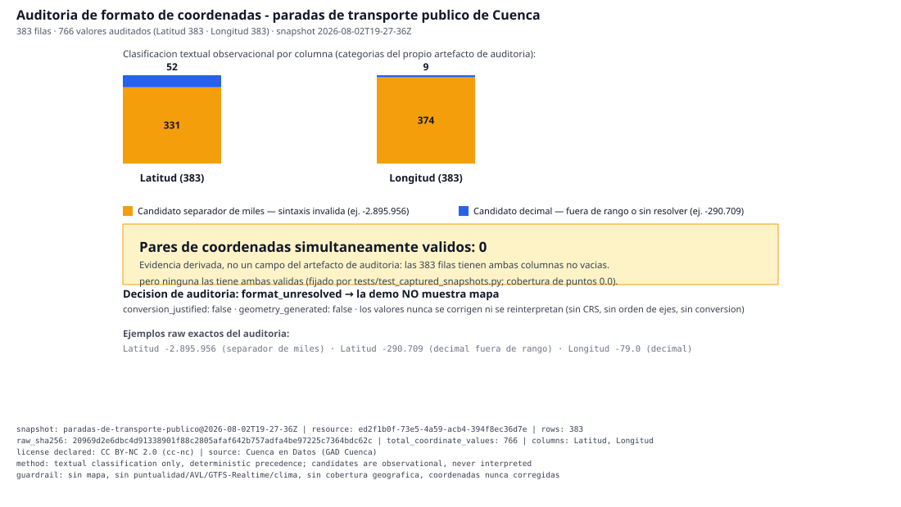
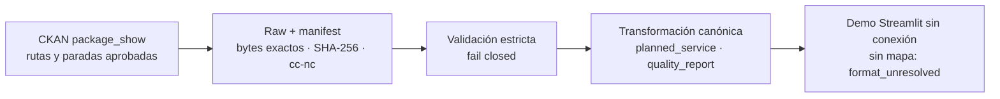

# Auditoría del servicio planificado de transporte público de Cuenca

> Una auditoría reproducible del servicio **planificado** de transporte público de Cuenca, construida solo con los dos snapshots aprobados de Cuenca en Datos (rutas y paradas): validación estricta contra manifiestos, transformación canónica `planned_service` y una demo local de solo lectura. **Este proyecto NO mide retrasos reales, puntualidad ni frecuencia observada, y NO produce mapa.**

**Estado:** `planned-service-audit` · `demo-ready` · `portfolio-ready` — las métricas describen dos snapshots aprobados (rutas y paradas); el análisis geográfico y meteorológico son trabajo futuro, no implementado.


*Captura de la demo en **modo demostración**: los datos mostrados son completamente sintéticos (`data/demo/synthetic-combined.json`), no son datos oficiales y no describen el servicio real de Cuenca. El modo evidencia real se ejecuta localmente solo cuando están presentes los raws aprobados.*

## 🧭 En una mirada

- **Qué es:** una auditoría reproducible del servicio **planificado** (lo que la fuente publica), no de la operación real. Rutas: 76 filas · Paradas: 383 filas · `planned_service` (transformación canónica): 228 registros (76 rutas × 3 tipos de día).
- **Cómo se garantiza la evidencia:** cada captura se valida de forma estricta contra su manifest (fail closed): licencia `cc-nc`, recurso CSV aprobado más reciente, SHA-256 de los bytes raw, UTF-8 y conteo de filas. Nada se corrige ni se re-escribe en silencio.
- **Por qué no hay mapa:** la auditoría de coordenadas concluye `format_unresolved` — el formato, el orden de ejes y el CRS no están resueltos. **0 pares de coordenadas simultáneamente válidos** en las 383 paradas — evidencia derivada de la transformación y fijada por `tests/test_captured_snapshots.py`, no un campo del artefacto de auditoría. Es una decisión de calidad de datos, no una función faltante.
- **Qué no es:** no mide puntualidad, retrasos, cancelaciones, posiciones de vehículos (AVL), GTFS-Realtime, clima ni cobertura geográfica.

## 🔎 Evidencia principal

### La auditoría de coordenadas explica la decisión de no mostrar mapa



Los valores tipo `-2.895.956` (separador de miles) son sintaxis inválida para un decimal; los tipo `-290.709` están fuera del rango de latitud. Aunque algunos valores aislados parecen plausibles (p. ej. `-79.0`), ninguna fila tiene **ambas** coordenadas válidas — los 0 pares válidos son evidencia derivada (ver tabla), no un campo del artefacto de auditoría — y sin resolución oficial del formato no se genera geometría ni mapa. Detalle completo: [`docs/coordinate-quality-audit.md`](docs/coordinate-quality-audit.md).

### Métricas de los dos snapshots aprobados

| Snapshot | Hechos verificados |
| --- | --- |
| Rutas `2026-08-02T18-51-08Z` (76 filas) | ORIGEN/DESTINO sin valor en 4 filas · SENTIDO IDA 38 / RETORNO 38 · 684 celdas de horario (0 malformadas) · 228 intervalos (0 inválidos) · 8 ventanas sin servicio (líneas 21 y 23, Sábado/Domingo) · 0 duplicados · **68/76 filas limpias** del snapshot validado (nunca cobertura de red) |
| Paradas `2026-08-02T19-27-36Z` (383 filas) | 0 duplicados · decisión `format_unresolved` · **auditoría** (`coordinate-format-audit.json`): latitud 331 separador de miles / 52 decimales; longitud 374 / 9 · **derivado de la transformación** (fijado por `tests/test_captured_snapshots.py`): latitud 331 sintaxis inválida / 48 fuera de rango / 4 válidas; longitud 374 / 4 / 5 · **0 pares válidos (cobertura de puntos 0,0)** · 5 valores de `Ubicacion` con `?` literal |

Evidencia de fuente (modo evidencia real): rutas → recurso `e55af215-4648-4e3b-84c9-d7e929435008` (`GADCuenca_RutasTransporte_2025Marzo.csv`), SHA-256 `dc3082ad…88ee07a`; paradas → recurso `ed2f1b0f-73e5-4a59-acb4-394f8ec36d7e` (`GADCuenca_ParadasTransporte_2025Abril.csv`), SHA-256 `20969d2e…bdc62c`. Ambas bajo licencia declarada CC BY-NC 2.0 (`cc-nc`).

## Cómo funciona



1. **Capturar** — un snapshot actual por dataset aprobado (`uv run python -m mobility_reliability.ingestion.ckan_snapshot --dataset all`), conservando bytes exactos y manifiestos pequeños versionados en `data/manifests/`; nunca sobrescribe, nunca descarga lotes históricos.
2. **Validar** — estructural y estricta: licencia, recurso seleccionado (CSV más reciente, nunca geometría/ZIP/ODS), hashes, UTF-8, conteos. Un manifest fallido histórico se repara solo con un sidecar `.manifest.correction.json`; el original queda inmutable.
3. **Transformar** — `source_snapshot`, `mobility_network`, `planned_service` y `quality_report`, con incidencias de calidad observables por campo; los horarios se conservan relativos al día de servicio y el centinela `0:00/0:00/0:00` es `no_service`, nunca una ventana activa.
4. **Mostrar** — una app Streamlit de solo lectura con cuatro vistas (servicio planificado, calidad de rutas, calidad de paradas, evidencia/provenance) y modos evidencia real / demostración sintética con fail-closed. Mapeo fuente → canónico: [`docs/source-to-canonical-mapping.md`](docs/source-to-canonical-mapping.md).

## Ejecutar la demo

```bash
UV_OFFLINE=1 uv sync --extra demo        # instala streamlit desde la caché local, sin red
uv run --extra demo streamlit run app/streamlit_app.py
```

- **Modo evidencia real:** ambos raws aprobados presentes en `data/raw/` → snapshots exactos, hashes inmutables y auditoría real.
- **Modo demostración (sintético):** checkout limpio sin raws → valores ficticios etiquetados de forma prominente como no oficiales; nunca se muestran hashes, IDs de recurso ni licencias reales.
- Evidencia parcial, malformada o inválida → cartel de error claro, **sin respaldo sintético**.
- Suite: `uv run pytest` (252 casos; los tests AppTest requieren el extra `demo`).
- Recorrido de 60–90 segundos: [`docs/demo-script.md`](docs/demo-script.md). Fixture y su reutilización: [`data/demo/README.md`](data/demo/README.md).

### Vistas de la demo (modo evidencia real)

| Vista | Qué muestra |
| --- | --- |
| Servicio planificado | 76 rutas por tipo de día: ventanas e intervalos planificados (H:MM raw + minutos), estado Activo/Sin servicio/Inválido, las 8 ventanas sin servicio |
| Calidad de rutas | 76 filas: 4 ORIGEN/DESTINO sin valor, IDA 38/RETORNO 38, 684 celdas, 228 intervalos, `68/76` filas limpias del snapshot validado |
| Calidad de paradas | 383 filas: conteos de coordenadas, decisión `format_unresolved`, ejemplos raw exactos limitados |
| Evidencia y provenance | IDs de snapshot/recurso, SHA-256 raw, marcas de recopilación, licencia y atribución |

## Captura de snapshots

```bash
uv run python -m mobility_reliability.ingestion.ckan_snapshot --dataset routes
uv run python -m mobility_reliability.ingestion.ckan_snapshot --dataset stops
# ambos datasets: --dataset all
```

Cada ejecución escribe un raw y un manifest y **nunca sobrescribe** (fail closed antes de cualquier llamada de red si el destino existe). Las dos capturas autorizadas se ejecutaron una sola vez cada una (2026-08-02); un manifest fallido histórico se conserva inmutable con un sidecar `.manifest.correction.json` (`status: superseded`). No volver a ejecutar sin una autorización nueva y explícita.

## Para quién y qué responde

- **Usuarios del transporte** que quieren saber cuándo hay servicio planificado y dónde existe cobertura.
- **Planificadores urbanos y de tránsito** que evalúan la cobertura publicada y su evolución entre snapshots.
- **Candidatos de datos y ML** que demuestran ingestión, validación estricta, transformación y calidad de datos sobre un dataset real y permitido.

Pregunta central que el proyecto responde con evidencia: **¿qué dice la fuente oficial que está planificado, y qué tan confiable es ese dato?** — y la segunda pregunta, igual de importante: qué es lo que todavía **no** se puede afirmar (puntualidad, geografía, clima).

## Estructura

```text
app/streamlit_app.py                  demo de solo lectura (4 vistas, fail closed)
mobility_reliability/                 paquete probado: ingestión, validación, transformación
  ├── ingestion/                      captura CKAN con manifiestos y corrección de huérfanos
  ├── validation/                     validación estricta manifest/raw
  └── transformation/                 source_snapshot · mobility_network · planned_service
data/manifests/                       manifiestos versionados (+ sidecar de corrección)
data/quality/coordinate-format-audit.json   auditoría de coordenadas (format_unresolved)
data/demo/synthetic-combined.json     fixture sintético de demostración (no oficial)
docs/                                 contratos de fuente, auditoría, mapeo y guion
```

## ⚠️ Limitaciones

- **Servicio planificado únicamente.** GTFS estático publica lo planificado; no contiene posiciones de vehículos, llegadas observadas ni retrasos medidos. Puntualidad, cancelaciones y posiciones de vehículos están **fuera de alcance** hasta contar con una fuente GTFS-Realtime/AVL **autorizada** (una URL alcanzable no autoriza nada).
- **Coordenadas sin resolver (`format_unresolved`).** No hay conversión, reproyección ni geometría; los valores nunca se corrigen y no se aplica ninguna bounding box. El mapa sigue bloqueado por esta decisión de calidad.
- **Sin contexto meteorológico.** INAMHI/NCEI/Open-Meteo están documentados en `docs/source-contract.md` como candidatos, pero nada fue recopilado ni analizado; no hay afirmaciones de causalidad clima-servicio.
- **Sin análisis entre snapshots ni series temporales.** Los dos snapshots son capturas puntuales; no se afirma frescura ni evolución.
- **Sin cobertura de toda la ciudad.** 76 rutas y 383 paradas son lo que publica la fuente aprobada, no una verificación independiente de la red.
- **Demostración sintética claramente etiquetada.** Los valores del modo demostración son ficticios y no describen el servicio real de Cuenca.

## Documentación

| Documento | Contenido |
| --- | --- |
| [`docs/source-contract.md`](docs/source-contract.md) | Contrato autoritativo de fuente, alcance, licencias y reglas de captura |
| [`docs/coordinate-quality-audit.md`](docs/coordinate-quality-audit.md) | Auditoría de coordenadas y decisión `format_unresolved` |
| [`docs/source-to-canonical-mapping.md`](docs/source-to-canonical-mapping.md) | Mapeo exacto de columnas fuente → modelo canónico |
| [`docs/demo-script.md`](docs/demo-script.md) | Guion del recorrido de la demo |
| [`data/demo/README.md`](data/demo/README.md) | Autoría y límites del fixture sintético |

Artefactos versionados: `data/manifests/` (manifiestos + sidecar de corrección), `data/quality/coordinate-format-audit.json`, `data/demo/synthetic-combined.json`. Los raws (`data/raw/`) están en `.gitignore` y no se redistribuyen por licencia.

## Licencia

**Código del repositorio.** MIT (ver `LICENSE`).

**Datos y contenido de terceros.** Los datos fuente, capturas raw, manifests, fixtures y demás contenido externo no quedan cubiertos por MIT: conservan sus términos independientes documentados (ver `docs/source-contract.md`; licencia declarada CC BY-NC 2.0) y no se otorga ningún derecho implícito sobre material de terceros. Las afirmaciones de licencia son registros técnicos de compatibilidad, no asesoramiento legal.
